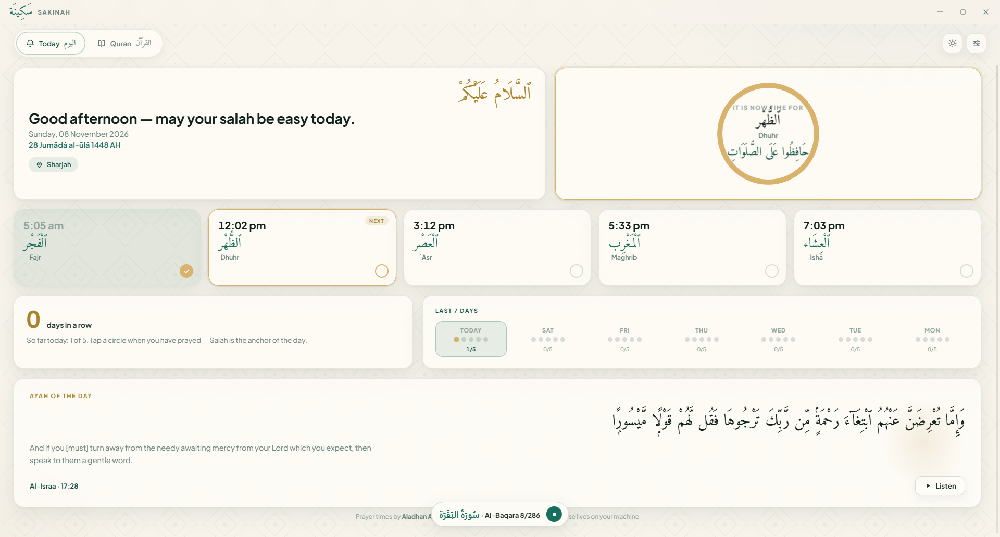
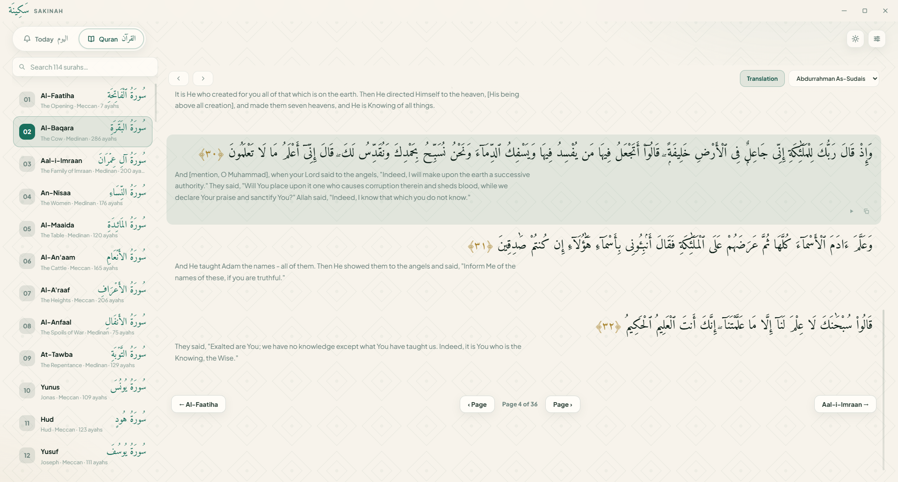

# Sakinah · سَكِينَة

<p lang="ar" dir="rtl" align="center"><b>ٱلسَّلَامُ عَلَيْكُمْ</b></p>

**A calm Quran & salah companion for your desktop and phone.**
Read the whole Quran offline, keep your five daily salah check-offs, follow your
streak, and listen to six famous reciters — all in a peaceful, ad-free app.

| Dashboard | Quran reader |
|---|---|
|  |  |

> **Why "Sakinah"?** *Sakīnah* (سَكِينَة) is the Quranic word for a divine calm
> and tranquility — the feeling this app is built around.

---

## ✨ Features

- 📖 **The whole Quran, offline** — all 114 surahs (Uthmani script + English
  translation) bundled with the app; the Amiri mushaf font is embedded.
- 📄 **Read your way** — mushaf-style flip pages (`‹ Page · Page k of N · Page ›`,
  arrow keys), free scrolling, and a searchable surah list. Flipping past the
  last page continues into the next surah.
- 🎧 **Six reciters** — Al-Afasy, Abdul Basit, As-Sudais, Ash-Shatri, Al-Husary,
  Al-Minshawi. Ayah-by-ayah playback with **preloaded streaming** so recitation
  flows seamlessly (Ayah-of-the-day intentionally plays just the one ayah).
- ⏰ **Gentle prayer reminders** — notifications from the Windows tray, even
  while the window is closed to the tray. Auto location detect (or manual) and
  all Aladhan calculation methods.
- ✅ **Salah check-offs & streaks** — five chips, a 7-day grid, and a streak
  counter. Everything stays on your machine.
- 🌗 **Light & dark themes** that follow Windows, Hijri + Gregorian dates,
  Ayah of the day, mini player bar with reachable Stop.
- 📱 **Android build** — the same calm UI as an APK (Capacitor wrapper).

## 📥 Download

Ready-made builds (Windows installer + Android APK) live on the
**GitHub Releases** page of this repository, and on the project website:

> <https://vermillion-pony-89c61c.netlify.app>

Windows SmartScreen may warn about the **unsigned** installer — choose
*More info → Run anyway*. (Today's installer is not code-signed; the app is
open-source, so you can build it yourself right here.)

## 🗂 Repository layout

```
Sakinah/
├── index.html      # renderer shell (plain HTML/CSS/JS — no frameworks)
├── main.js         # Electron main process: tray, scheduler, notifications
├── preload.js      # context-isolated IPC bridge (window.sakinah)
├── src/            # UI sources (html/css/js + bundled Quran data & fonts)
├── mobile/         # Capacitor Android project (wraps src/, see mobile/README?)
├── site/           # the download website (deployed on Netlify)
└── dist/           # build output (not committed)
```

## 🛠 Build from source

### Desktop (Windows) — Electron

```powershell
npm install
npm start          # run in development
npm run dist       # build the NSIS installer into dist\
```

Prereqs: Node.js 18+ (tested with Node 26). Everything works without admin.

### Android — Capacitor

Prereqs: JDK 21, Android SDK (platform 35 + build-tools 35.0.0).

```powershell
cd mobile
npm install
# copy the UI sources in (matching its capacitor.config.json webDir):
#   copy everything from ../src into mobile/www/
npx cap sync android
cd android
.\gradlew.bat assembleDebug     # → app\build\outputs\apk\debug\app-debug.apk
```

## 🔐 Privacy

No accounts, no keys, no analytics, no data collection. Salah check-offs and
settings live in local storage on your device. The only network calls are:
prayer times (api.aladhan.com), IP→city lookup (ipwho.is), and recitation audio
(cdn.islamic.network). Quran text, fonts and translations are bundled and work
fully offline.

## 🙏 Credits & data sources

- **Quran text & translations** — [AlQuran Cloud](https://alquran.cloud) /
  [Tanzil](https://tanzil.net) (public-domain Uthmani text and English
  translations)
- **Prayer times & calendar** — [Aladhan](https://aladhan.com) API
- **Recitation audio** — [islamic.network](https://cdn.islamic.network) CDN
- **Fonts** — [Amiri](https://www.amirifont.org) and
  [Plus Jakarta Sans](https://github.com/tokotype/PlusJakartaSans) (OFL),
  via Google Fonts
- **Kit** — [Electron](https://electronjs.org),
  [Capacitor](https://capacitorjs.com), Chromium, NSIS

All credit for the text of the Quran belongs to Allah; thank you to the
maintainers of the free services above.

## ⚖ License

Released under the [MIT License](LICENSE). Third-party data/fonts keep their
own licenses. *This is a beta app by a small, human team — may it be of
benefit, وَجَعَلَهُ ٱللَّهُ فِي مِيزَانِ حَسَنَاتِكُم.*
